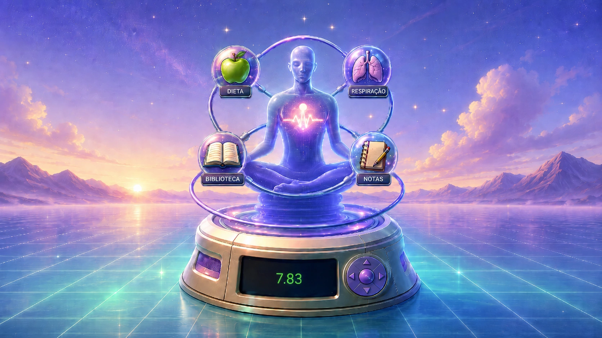
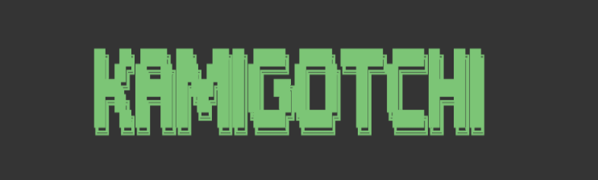

<div align="center">


<details>
<summary>Abrir portfólio</summary>

<br>

# LIQUIFINITY

### Independent computational laboratory.

**We build systems, worlds and tools from first principles.**

From machine discovery and deterministic runtimes to interactive worlds and human-centered software.

<sub>AI DISCOVERY · COMPUTATIONAL SYSTEMS · DIGITAL WORLDS · HUMAN TOOLS</sub>

<br><br>

---

## WHAT WE BUILD

<table>
<tr>
<td width="33%" align="center" valign="top">
<h3>MACHINE INTELLIGENCE</h3>
<p>How can machines access, understand and represent the web?</p>
<p><strong>GEO / CEUGEO</strong></p>
</td>
<td width="33%" align="center" valign="top">
<h3>COMPUTATIONAL WORLDS</h3>
<p>Rules become runtimes. Runtimes become worlds.</p>
<p><strong>NUMERARE · SNEK RENAISSANCE</strong></p>
</td>
<td width="33%" align="center" valign="top">
<h3>HUMAN SYSTEMS</h3>
<p>Complex information turned into usable tools.</p>
<p><strong>PULSO 99 · AUTONOMIA DIGITAL 50+</strong></p>
</td>
</tr>
</table>

<br>

---

## CURRENT WORK

<br>

<div align="left">

### 01 — GEO / CEUGEO

#### How does an AI actually see the web?

Evidence-first infrastructure for observing how machines access, render, understand, discover, retrieve, cite and represent a web entity.

```text
OBSERVATION → EVIDENCE → METHOD → INTERPRETATION → CONFIDENCE
```

The goal is not a magic score. The goal is to preserve enough evidence, method and lineage to make observations explainable and comparable over time.

`ACTIVE RESEARCH · MACHINE DISCOVERY · OBSERVATION INFRASTRUCTURE`

<br>

### 02 — NUMERARE

#### Build worlds from rules.

A computational laboratory for languages, runtimes, generative systems and experimental worlds.

```text
RULES
  ↓
LANGUAGE
  ↓
RUNTIME
  ↓
WORLD
```

Current research lines include **BIOGENESIS**, **WORLD LAB** and **WORLD MATH**. They remain experimental systems under active development — not finished products presented as certainty.

`ACTIVE LAB · COMPUTATIONAL SYSTEMS · WORLD ENGINES`

<br>

### 03 — SNEK RENAISSANCE

#### An ancient game rebuilt as a deterministic 3D world.

> **A new experiment with an ancient spirit.**  
> **Borders? Just an illusion.**

A browser experiment built around a deterministic Snake core inside a toroidal three-dimensional grid.

```text
9 × 9 × 9
TOROIDAL SPACE
DETERMINISTIC MOVEMENT
ZERO BORDERS
```

<p align="center">
<a href="https://github.com/Liquifinity/snekrenaissance"><strong>［ ENTER SNEK RENAISSANCE ］</strong></a>
</p>

`PUBLIC · ACTIVE DEVELOPMENT · GAME / WORLD EXPERIMENT`

</div>

<br>

---

## SYSTEMS WE HAVE BUILT

<br>

<table>
<tr>
<td width="50%" align="center" valign="top">
<a href="https://pulsar99.com.br/"></a>
<h3>PULSO 99 / OKINAVI</h3>
<p>A personal system connecting food, breathing, study, knowledge and organization through a living interface.</p>
<p><a href="https://pulsar99.com.br/"><strong>［ OPEN SYSTEM ］</strong></a></p>
</td>
<td width="50%" align="center" valign="top">
<a href="https://autonomiadigital50mais.com.br/"></a>
<h3>AUTONOMIA DIGITAL 50+</h3>
<p>Technology education designed to turn digital dependence into practical autonomy.</p>
<p><a href="https://autonomiadigital50mais.com.br/"><strong>［ EXPLORE PROJECT ］</strong></a></p>
</td>
</tr>
<tr>
<td width="50%" align="center" valign="top">
<a href="https://tweak-production.up.railway.app/"></a>
<h3>TWEAK</h3>
<p>Business operations represented as navigable environments. Companies become places; operational context becomes visible.</p>
<p><a href="https://tweak-production.up.railway.app/"><strong>［ EXPLORE TWEAK ］</strong></a></p>
</td>
<td width="50%" align="center" valign="top">
<a href="https://app.kamigotchi.io/"></a>
<h3>KAMIGOTCHI / SACREDMANTIS</h3>
<p>Persistent digital creatures, evolving cycles and independent automation around a living game world.</p>
<p><a href="https://app.kamigotchi.io/"><strong>［ KAMIGOTCHI ］</strong></a> · <a href="https://prayingmantis.fun/"><strong>［ SACREDMANTIS ］</strong></a></p>
</td>
</tr>
</table>

<br>

---

## HOW WE BUILD

**A project starts as a question — not as a claim.**

```text
QUESTION → MODEL → PROTOTYPE → EVIDENCE → SYSTEM → ITERATION
```

<table>
<tr>
<td width="50%" align="left" valign="top">
<h3>Working systems over presentations.</h3>
<p>Build something that can run before describing what it supposedly does.</p>
</td>
<td width="50%" align="left" valign="top">
<h3>Evidence over assumption.</h3>
<p>An observation never becomes a larger conclusion than the evidence can support.</p>
</td>
</tr>
<tr>
<td width="50%" align="left" valign="top">
<h3>Architecture before scale.</h3>
<p>Authority, boundaries and contracts are made explicit before complexity compounds.</p>
</td>
<td width="50%" align="left" valign="top">
<h3>Experiments remain experiments.</h3>
<p>Research in progress is presented as research in progress — not as a finished product.</p>
</td>
</tr>
</table>

<br>

---

## PUBLIC RESEARCH

<div align="left">

### DarkFi Faucet Lab

Reproducible **Rust / WASM** engineering experiments for decentralized testnet infrastructure, focused on architecture, contracts, security and verifiable behavior.

```text
Rust / WASM → FaucetPool → controlled top-up → validation
```

<p align="center">
<a href="https://github.com/Liquifinity/darkfi-faucet-lab"><strong>［ VIEW PUBLIC RESEARCH ］</strong></a>
</p>

</div>

<br>

---

### Build what can be tested. Preserve what can be proven. Keep exploring what remains unknown.

<sub>LIQUIFINITY · SYSTEMS / WORLDS / EVIDENCE · 2026</sub>

<br><br>

</details>


</div>
